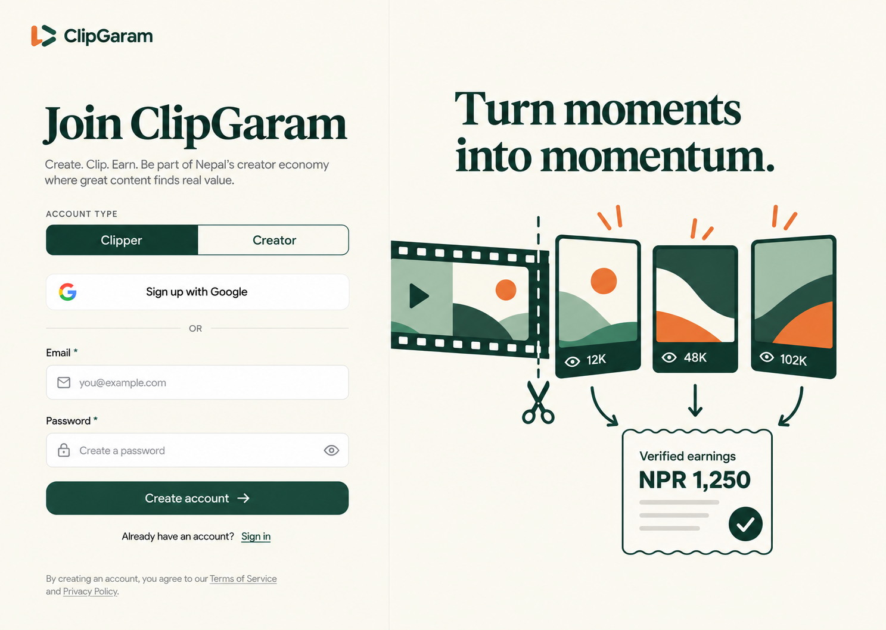
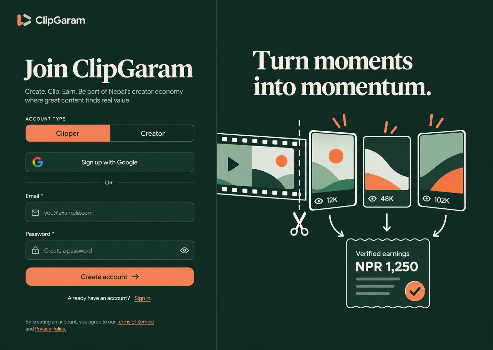

<p align="center">
  
</p>

<h1 align="center">ClipGaram</h1>

<p align="center">
  <strong>A creator × clipper marketplace built for Nepal 🇳🇵</strong>
</p>

<p align="center">
  Connecting creators with clippers to turn great content into high-performing short-form clips.
</p>

<p align="center">
  
  
  
  
</p>

---

## What is ClipGaram?

**ClipGaram** is a platform designed to connect content creators with video clippers.

Creators can publish clipping opportunities and find talented people who can transform their long-form content into engaging short-form videos.

Clippers get a place to discover creators, participate in clipping opportunities, showcase their editing skills, and earn from their work.

The idea is simple:

> **Creators create. Clippers amplify. ClipGaram connects them.**

ClipGaram is being built with an initial focus on Nepal's growing creator economy, with the vision of expanding beyond it.

---

## Preview

### Light Mode

<p align="center">
  
</p>

### Dark Mode

<p align="center">
  
</p>

---

## Features

### Available / In Development

- **Creator & Clipper onboarding** — choose how you want to use ClipGaram.
- **Responsive authentication** — designed specifically for desktop and mobile.
- **Animated mobile onboarding** — an interactive introduction before authentication.
- **Light & Dark Mode** — a consistent experience across both themes.
- **Reusable design system** — shared colors, typography, spacing, and UI tokens.
- **Responsive UI** — layouts and interactions adapt naturally across screen sizes.

### Planned

- 🎬 Creator campaigns
- ✂️ Clipper marketplace
- 📤 Clip submission system
- 💰 Rewards and payments
- 📊 Creator analytics
- 📈 Clipper performance tracking
- 🔍 Creator and campaign discovery
- 🔔 Notifications
- 👤 Creator & Clipper profiles
- 🛡️ Moderation and administration tools

---

## How ClipGaram Works

```text
CREATOR
   │
   ├── Creates a campaign
   │
   ├── Adds content
   │
   └── Sets clipping requirements
              │
              ▼
          CLIPGARAM
              │
              ▼
           CLIPPERS
              │
   ├── Discover campaigns
   ├── Create short-form clips
   └── Submit their work
              │
              ▼
       Creator reviews clips
              │
              ▼
        Clipper gets rewarded
```

---

## Tech Stack

| Technology | Purpose |
|---|---|
| **React** | Frontend user interface |
| **TypeScript** | Type-safe application development |
| **Vite** | Development & build tooling |
| **CSS** | Styling, animations & responsive design |
| **Vitest** | Testing |

---

## Getting Started

> **Note:** ClipGaram is proprietary software. Access to this repository does not grant permission to copy, redistribute, modify, or commercially use the source code.

### 1. Clone the repository

```bash
git clone https://github.com/BlackInOne69/ClipGaram.git
```

### 2. Enter the project

```bash
cd ClipGaram
```

### 3. Install dependencies

```bash
npm install
```

### 4. Start the development server

```bash
npm run dev
```

Vite will display the local development URL in the terminal.

---

## Production Build

Create a production build with:

```bash
npm run build
```

---

## Project Structure

```text
ClipGaram/
│
├── references/
│   ├── previews/
│   ├── clipgaram-auth-style-guide.md
│   ├── clipgaram-theme.ts
│   └── clipgaram-tokens.css
│
├── scripts/
│
├── src/
│   ├── components/
│   │   └── auth/
│   ├── pages/
│   ├── styles/
│   ├── theme/
│   └── main.tsx
│
├── tests/
├── worker/
│
├── index.html
├── package.json
├── tsconfig.json
└── vite.config.mjs
```

---

## Design Philosophy

ClipGaram aims to feel **simple, playful, and human** rather than like a generic marketplace or dashboard.

The interface focuses on:

- Clear visual hierarchy
- Purposeful animation
- Minimal interfaces
- Strong typography
- Responsive interactions
- Consistent light and dark themes
- Mobile experiences designed specifically for smaller screens

The goal is to make ClipGaram feel like a product built **for creators and clippers**, not another generic marketplace.

---

## Roadmap

ClipGaram is currently in early development.

```text
Authentication & Onboarding     ██████████  In Development
Creator Dashboard               ░░░░░░░░░░  Planned
Clipper Dashboard               ░░░░░░░░░░  Planned
Creator Profiles                ░░░░░░░░░░  Planned
Campaign System                 ░░░░░░░░░░  Planned
Clip Submission                 ░░░░░░░░░░  Planned
Analytics                       ░░░░░░░░░░  Planned
Payments                        ░░░░░░░░░░  Planned
Notifications                   ░░░░░░░░░░  Planned
```

---

## Why ClipGaram?

Short-form content has become one of the most powerful ways for creators to reach new audiences.

But consistently turning long-form content into quality short-form clips requires time, editing skills, and distribution effort.

At the same time, talented editors and aspiring clippers need opportunities to work with creators and monetize their skills.

**ClipGaram brings both sides together.**

---

## Development Status

🚧 **ClipGaram is currently under active development.**

The current version primarily focuses on the authentication, onboarding, responsive experience, and core design system.

More of the platform will be introduced as development progresses.

---

## License

**Copyright © 2026 BlackInOne69. All Rights Reserved.**

ClipGaram is **proprietary software**.

The source code, designs, assets, branding, documentation, and other materials contained in this repository may not be copied, modified, reproduced, distributed, sublicensed, sold, or used commercially without explicit written permission from the copyright holder.

Public availability of the repository or source code does **not** grant any license or ownership rights.

See [LICENSE](LICENSE) for full license terms.

---

## Author

Built and maintained by **BlackInOne69**.

GitHub: [@BlackInOne69](https://github.com/BlackInOne69)

---

<p align="center">
  <strong>Creators create. Clippers amplify.</strong>
</p>

<p align="center">
  Built with ❤️ in Nepal 🇳🇵
</p>